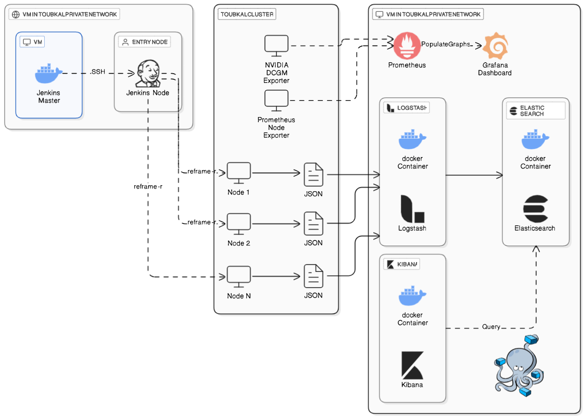

# RedX – SRE & DevOps for HPC/GPU Clusters

An automated **testing and observability pipeline** for the **Toubkal HPC cluster**. It combines:

- **Jenkins** to trigger [ReFrame](https://reframe-hpc.readthedocs.io/) regression tests across cluster nodes
- **ELK stack** (Logstash, Elasticsearch, Kibana) to ingest and explore test results
- **Prometheus + Grafana** with **NVIDIA DCGM** and **Node Exporter** to monitor GPU and node health

---

## 🧱 Architecture



The system is split into three zones:

### 1. CI/CD Control (VM in Toubkal private network)
- **Jenkins Master** runs in a Docker container.
- It connects over **SSH** to a **Jenkins Node** running on the cluster's **entry node**.
- The Jenkins Node launches `reframe -r` on the target compute nodes (Node 1, Node 2, … Node N).

### 2. Toubkal Cluster
- Each node runs ReFrame tests and produces a **JSON report**.
- **NVIDIA DCGM Exporter** exposes GPU metrics.
- **Prometheus Node Exporter** exposes system metrics (CPU, memory, disk, network).

### 3. Observability (VM in Toubkal private network)
Everything runs as Docker containers managed with **Docker Compose**.

| Pipeline | Flow |
|----------|------|
| **Test results** | ReFrame JSON → **Logstash** → **Elasticsearch** → **Kibana** (query & visualize) |
| **Metrics** | DCGM + Node Exporter → **Prometheus** → **Grafana** dashboards |

---

## 📁 Repository Structure

```
.
├── DEVOPS-STACK/     # Docker Compose stack: ELK, Prometheus, Grafana, Jenkins
├── GPU/              # GPU monitoring / testing (DCGM exporter, GPU tests)
├── assets/
│   └── architecture.png
└── README.md
```

---

## 🧰 Tech Stack

| Area | Tools |
|------|-------|
| CI/CD | Jenkins (master + SSH node) |
| HPC testing | ReFrame |
| Containers | Docker, Docker Compose |
| Log pipeline | Logstash, Elasticsearch, Kibana |
| Metrics | Prometheus, Grafana |
| Exporters | NVIDIA DCGM Exporter, Prometheus Node Exporter |

---

## 🚀 Getting Started

### Prerequisites
- Access to the Toubkal private network
- Docker & Docker Compose on the monitoring VM and the Jenkins VM
- SSH access from the Jenkins Master to the cluster entry node
- ReFrame installed on the cluster
- NVIDIA drivers on GPU nodes

### 1. Clone the repository
```bash
git clone https://github.com/medkarim19/redx-sre-devops.git
cd redx-sre-devops
```

### 2. Start the monitoring & logging stack
```bash
cd DEVOPS-STACK
docker compose up -d
```

### 3. Deploy exporters on the cluster
Run the following exporters on the cluster nodes so Prometheus can scrape them:

- **NVIDIA DCGM Exporter** for GPU metrics
- **Prometheus Node Exporter** for system metrics

### 4. Configure Jenkins
1. Start the Jenkins Master container.
2. Add the cluster entry node as a Jenkins agent over SSH.
3. Create a pipeline job that runs ReFrame on the target nodes.

### 5. Run the tests
```bash
reframe -c <checks_path> -r --report-file=report.json
```
The JSON report is picked up by Logstash and indexed in Elasticsearch.

---

## 📊 Accessing the Dashboards

| Service | Purpose | Default port |
|---------|---------|--------------|
| Grafana | GPU & node metrics dashboards | `3000` |
| Prometheus | Metrics storage & queries | `9090` |
| Kibana | ReFrame test results explorer | `5601` |
| Elasticsearch | Search & storage backend | `9200` |

---

## 🔄 How It Works

1. A Jenkins job is triggered (manually or on schedule).
2. Jenkins Master delegates to the Jenkins Node on the cluster entry node via SSH.
3. The node runs `reframe -r` on cluster nodes.
4. Each node writes a JSON test report.
5. Logstash ingests the reports and forwards them to Elasticsearch.
6. Kibana queries Elasticsearch to visualize pass/fail trends and performance.
7. In parallel, Prometheus scrapes DCGM and Node Exporter, and Grafana displays live health metrics.
